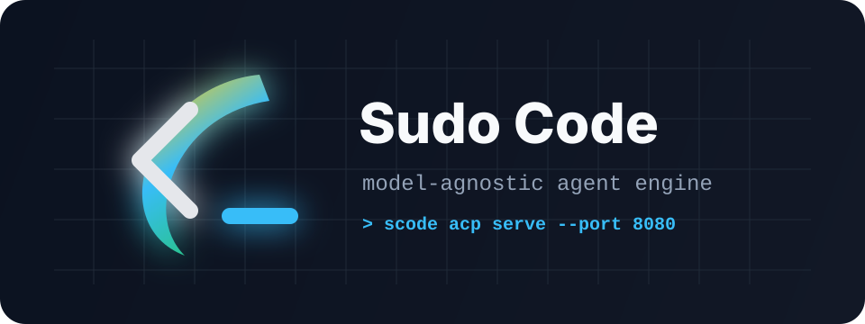
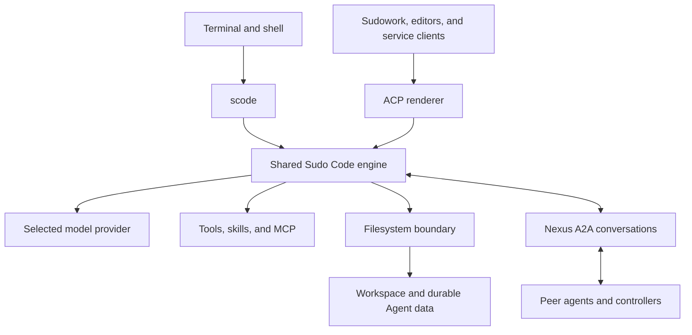

# SUDO CODE

<p align="center">
  
</p>

<p align="center">
  <a href="#license"></a>
  
  
  <a href="docs/acp.md"></a>
  <a href="CONTRIBUTING.md"></a>
</p>

## FOR HACKERS.

Sudo Code (`scode`) is a Rust coding agent for terminal users. It edits files,
runs tools, preserves readable sessions, and works with the model provider you
choose. Use it interactively, in shell scripts, or through ACP from an editor
or [Sudowork](https://sudowork.sudoprivacy.com).

<p align="center">
  
</p>

## Design principles

These principles define the product. Engineering tasks and acceptance evidence
live in the [roadmap](sudo-code-roadmap.html).

| Principle | Meaning |
|---|---|
| **Simple and capable.** | Keep concepts few and useful controls accessible. Make commands and defaults easy to understand. |
| **User control.** | Let users choose models, credentials, versions, and permissions. Make work interruptible and consequential actions explicit. |
| **Inspectable work.** | Show commands, paths, diffs, failures, and costs. Keep important activity easy to scan and details available to inspect. |
| **Preserve the record.** | Keep input, conversation history, and terminal scrollback through ordinary interaction and resize. Explain recovery choices before discarding work. |
| **Responsive interaction.** | Measure typing, cancellation, resize, and long sessions through real terminal workflows. |
| **Small runtime memory.** | On unified-memory machines, agent processes share physical memory with the GPU running a local model. Keep room for model weights and KV caches, especially with parallel agents. Track peak RSS and growth across turns in [performance CI](https://github.com/sudoprivacy/sudocode/actions/workflows/render-performance.yml); [measurement scope](#runtime-footprint) accompanies every result. |
| **Compose through one engine.** | Terminal, ACP, and cohost renderers use the same engine boundary. The shell, editors, and Sudowork supply their own interaction and orchestration surfaces. |
| **Portable Agent identity.** | Cohost and standalone share the [Agent storage contract](docs/design/agent-context-storage-matrix.html#agent-delivery-contract). Backends handle physical placement and transport. |
| **Durable facts, transient runtime state.** | Persist sessions, memory, configuration, attachments, and consumed message positions. Keep PID presence, live status, and process queues in their runtime layer. |
| **One source of truth.** | Put each capability and contract in its owning layer. Reuse that implementation and reference its documentation. |
| **Readable visual design.** | Use amber as the activity accent, semantic colors, and clear typography. Keep state understandable through text as well as color. |
| **Open and composable.** | MIT licensing, contributor copyright, explicit opt-in telemetry, inline terminal output, and provider choice are part of the product contract. |

### Runtime footprint

[Apple silicon](https://developer.apple.com/videos/play/wwdc2020/10686/) and
[NVIDIA DGX Spark](https://docs.nvidia.com/dgx/dgx-spark-porting-guide/overview.html)
share physical memory between CPU and GPU. Runtime memory therefore competes
with local inference memory.

The [runtime memory reference](docs/usage.md#runtime-memory)
defines RSS, measurement scope, and a recorded example. The
[release performance gate](e2e/terminal-resize/README.md#release-performance-gate)
describes workloads and regression checks; the
[versioned policy](e2e/terminal-resize/performance-policy.json) owns the budgets.

## Position in the larger picture

Sudo Code supplies the agent engine. Sudowork supplies a UI; Nexus supplies
storage, communication, and managed runtime services.



The [engine boundary](rust/crates/engine-core/src/lib.rs) defines commands and
events between the engine and renderers. The
[crate map](rust/README.md) identifies their implementations.

Saved sessions keep compressed [raw response recordings](docs/response-recording.md)
for diagnosing streaming and protocol problems. Recordings stay beside the
session, with size limits and an option to disable them.

### Agent communication and hosting

Peer agents discover names with `agent_list` and exchange messages with `send`.
Nexus A2A uses conversations shared by their participants; the
[storage matrix](docs/design/agent-context-storage-matrix.html#agent-delivery-contract)
owns identity, directory links, durable delivery, and visibility contracts.
The [Nexus integration architecture](https://s.shareone.vip/s/nexus-integration-architecture#a2a)
owns transport framing and managed session control.

`agent_spawn` delegates a child task in the current process. Independent
managed Agents use Nexus's `ManagedAgentService`. Standalone `scode` and the
`nexusd-cohost` composition host the same engine through the filesystem and
session interfaces. The [shared service contract](https://s.shareone.vip/s/nexus-integration-architecture#shared-agent-home)
defines runtime ownership, installation, and the Sudowork integration boundary.
Implementation tasks live in [roadmap Goal 4](sudo-code-roadmap.html#goal-4).

## Install

On macOS or Linux:

```sh
curl -fsSL https://raw.githubusercontent.com/sudoprivacy/sudocode/main/install.sh | sh
```

The installer selects the host architecture and verifies the binary's SHA-256.
Use `sh install.sh --no-sudo` for a per-user installation, or set
`SCODE_INSTALL_DIR` to choose a directory. Set `SCODE_VERSION=vX.Y.Z` to pin a
release. Run `sh install.sh --help` for all options.

For downloads through the China mirror:

```sh
curl -fsSL https://sudowork-release-1309794936.cos.ap-beijing.myqcloud.com/sudocode/release/latest/install.sh | \
  SCODE_MIRROR=https://sudowork-release-1309794936.cos.ap-beijing.myqcloud.com/sudocode/release/latest sh
```

The mirror supplies the archive and its published checksum manifest. Windows binaries and
platform packages are available on the
[Releases page](https://github.com/sudoprivacy/sudocode/releases/latest).

The [installation and updates guide](docs/usage.md#installation-and-updates)
covers startup checks, mirror selection and version pinning. Configure a model
and credentials using the [authentication guide](docs/authentication.md).

## Quick Start

```sh
# Interactive terminal session
scode

# One-shot work and JSON output
scode "explain this codebase"
scode --output-format json prompt "list failing tests"

# Restore a saved session
scode --resume <session-id>

# ACP for an editor or Web client
scode acp
scode acp serve --port 8080

# Check configuration and runtime dependencies
scode doctor
```

The [usage guide](docs/usage.md) covers prompt editing, background tasks,
session recovery, configuration, and output formats. The
[ACP guide](docs/acp.md) covers transports, permissions, and session controls.
The [input controls](docs/usage.md#steering-queueing-and-cancellation) distinguish
steering current work, queueing the next turn, flushing, and cancellation.

## Build and contribute

```sh
git clone https://github.com/sudoprivacy/sudocode.git
cd sudocode/rust
cargo build --release
# Binary: target/release/scode
```

See [CONTRIBUTING.md](CONTRIBUTING.md) for prerequisites, required checks,
test policy, and the PR workflow. Discussion and issues are welcome in any
language; canonical project documentation is in English.

## Documentation

| Reference | Scope |
|---|---|
| [Roadmap](sudo-code-roadmap.html) | Engineering tasks and acceptance evidence |
| [Usage](docs/usage.md) | Terminal workflows and saved sessions |
| [Authentication](docs/authentication.md) | Model credentials and auth modes |
| [Permissions and sandbox](docs/permissions-and-sandbox.md) | Tool approval and execution boundaries |
| [ACP](docs/acp.md) | Editor and Web client protocol |
| [Agent storage matrix](docs/design/agent-context-storage-matrix.html) | Agent identity, durable paths, links, and delivery |
| [Nexus integration](https://s.shareone.vip/s/nexus-integration-architecture) | Runtime services and communication transport |
| [Models](docs/models.md) | Provider and model configuration |
| [Plugins](docs/plugins.md) | Skills, plugins, and MCP integration |
| [Containers](docs/container.md) | Container builds and startup |
| [Rust workspace](rust/README.md) | Crate boundaries and ownership |

## License

[MIT](LICENSE). Contributors retain their copyright.
