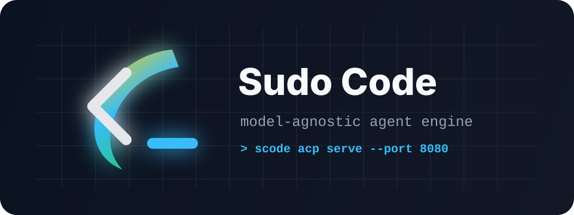
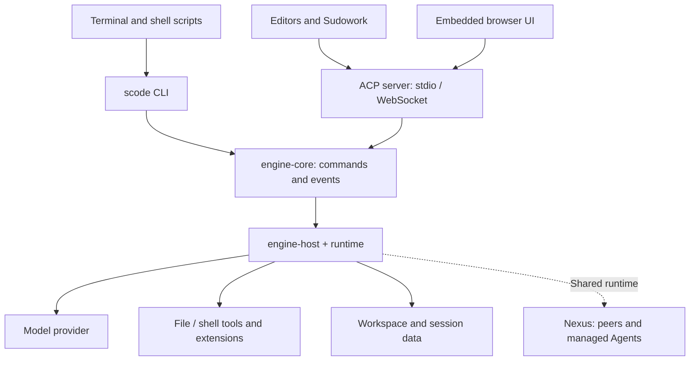

# Sudo Code

<p align="center">
  
</p>

<p align="center">
  <a href="#license"></a>
  
  
  <a href="docs/acp.md"></a>
</p>

**The hacker features of Claude Code and Codex CLI, in one Rust agent that
spends as little memory, CPU and tokens as possible.**

Sudo Code (`scode`) reads your codebase, edits files and runs commands with the
model, account and permissions you choose. Use it in a terminal, from a script,
or from an editor through the **Agent Communication Protocol (ACP)**. All three
share one agent engine.

[Principles](#design-principles) · [Measured cost](#measured-cost) ·
[Get started](#get-started) · [Everyday workflows](#everyday-workflows) ·
[Architecture](#architecture) · [Contribute](#build-and-contribute) ·
[Documentation](#documentation)

<p align="center">
  
</p>

## Design principles

Sudo Code follows two rules. Every feature and every change is judged by both.

1. **Take the hacker features from Claude Code and Codex CLI.**
2. **Keep performance and cost efficient to the extreme.**

### 1. Hacker features from Claude Code and Codex CLI

Sudo Code takes the power-user features of both tools and runs them on any
model provider. You stay in control: you choose the model, account, permissions
and version, and you can interrupt any work. No feature is hidden because
someone might misuse it.

| Feature | From |
| --- | --- |
| Skills, plugins, hooks and MCP servers; reads `.claude-plugin` manifests | Claude Code |
| Sub-agents, background tasks, context inspection, compaction and resume | Claude Code |
| `!` shell commands whose output becomes part of the conversation | Claude Code |
| Enter steers a running turn; Tab queues the next message | Codex CLI |
| `read-only`, `workspace-write` and `danger-full-access` permission modes | Codex CLI |
| Markdown, table, code-color and Mermaid rendering | Codex CLI |
| `AGENTS.md` project instructions; reads `.codex-plugin` manifests | Codex CLI |

On top of these, Sudo Code adds a provider, account or proxy per project; an
ACP server with a browser UI for editors and apps; and peer Agents through
Nexus. Output stays inline in your terminal, so native scrollback, pipes and
tmux keep working. There is no telemetry unless you opt in.

### 2. Efficiency to the extreme

Agents often run several at a time, on the same machine as a local model. Every
MiB the agent holds is taken from model weights and KV cache, and every prompt
token sent without a cache hit is paid for again. Sudo Code treats memory, CPU
and tokens as budgets:

- **Memory and CPU are gated.** Every change to the terminal interface is
  measured in a real terminal against a fixed baseline. It fails if it exceeds
  a hard ceiling or shows a statistically confident regression.
- **The prompt cache stays warm.** Provider caches match only a byte-exact
  prefix. Each session saves its system prompt and reuses it through turns,
  compaction, restarts and forks; the date stays out of the system prompt, and
  tools keep a fixed order. Tests capture the actual outgoing requests and check
  that the prefix holds.
- **Cost is visible.** Each turn shows its cache read and write share in the
  status line. `scode cache stats` reports cache reuse across sessions and
  classifies each cache break by cause.

## Measured cost

One `scode` process, release build, on Linux CI. A scripted model streams over
local HTTP, so network and model time are excluded. Each value is the median of
seven paired runs; ranges span seven workloads: short and long replies, a 12 KB
Markdown reply, foreground and background tasks, and a 30-turn session
([source run, 2026-10-28](https://github.com/sudoprivacy/sudocode/actions/runs/40774198468)).

| Metric | Measured | Budget |
| --- | ---: | ---: |
| Peak memory (RSS) | 30–35 MiB | 80 MiB |
| Memory growth over 30 turns | 1.8 MiB | 16 MiB |
| Typing latency, key to echo (P95), including while streaming | 3–4 ms | 50 ms |
| CPU per turn (stream a reply while typing, pasting and resizing) | 0.20–0.26 s | 0.8 s |
| CPU while idle at the prompt | ≤ 10 ms per second | — |
| Terminal output while idle | 0 bytes | 0 bytes |
| First text on screen after the model starts streaming | 59–78 ms | 3 s |
| Cancel, Esc to a ready prompt (P95) | 81 ms | 200 ms |
| Resize redraw (P95) | 41 ms | 100 ms |
| Paste (P95) | 2–3 ms | 100 ms |

Startup: `scode --version` takes a median 16 ms on an Intel Mac, against 5 ms
for a minimal Rust binary. Every release candidate must start in under 100 ms
on Linux, macOS and Windows. Downloads are 11–17 MB per platform.

Prompt cache in real use: on one maintainer's machine, 49 Anthropic sessions
(6,887 requests) read 88.5% of their cached prompt tokens back from the cache
and wrote only 11.5% anew.

These numbers cover the `scode` process alone; the tools it runs, the model
server and Nexus are measured separately. RSS includes shared pages. The
[performance gate](e2e/terminal-resize/README.md#release-performance-gate)
defines the workloads, and
[`performance-policy.json`](e2e/terminal-resize/performance-policy.json) holds
the budgets. [`scode cache stats`](CONTRIBUTING.md#measuring-prompt-cache-behaviour)
shows your own prompt-cache numbers.

<a id="quick-start"></a>

## Get started

<a id="install"></a>

### 1. Install

On **macOS or Linux**:

```sh
curl -fsSL https://raw.githubusercontent.com/sudoprivacy/sudocode/main/install.sh | sh
```

The installer selects the host architecture and verifies the archive's SHA-256
against the release checksum manifest. To inspect it first, download
[`install.sh`](install.sh); `sh install.sh --help` lists its options.

| Platform | Release architectures | Installation options |
| --- | --- | --- |
| macOS | Apple silicon, Intel | Shell installer or release archive |
| Linux | ARM64, x64 | Shell installer, release archive, or [Debian/Ubuntu package](docs/linux-deb-install.md) |
| Windows | ARM64, x64 | Extract the matching ZIP and add its directory to `PATH` |

Downloads are on [GitHub Releases](https://github.com/sudoprivacy/sudocode/releases/latest).
For an explicit per-user destination, run the downloaded script with
`--prefix "$HOME/.local/bin"`; `--no-sudo` prevents sudo use.
[Installation and updates](docs/usage.md#installation-and-updates) covers version
pinning, the China mirror, and `scode update`.

### 2. Configure a model and open your project

This example uses an **Anthropic API key** and the `sonnet` model alias:

```sh
export ANTHROPIC_API_KEY='your-api-key'
cd /path/to/your/repository
scode --auth api-key --model sonnet --permission-mode workspace-write
```

Try a concrete task:

> Find where requests are authenticated. Explain the flow, then add a regression
> test for an expired token.

This example selects `workspace-write`: file writes stay inside the workspace
and shell mutations request approval. The CLI's default permission mode is
`danger-full-access`. See [permissions and sandboxing](docs/permissions-and-sandbox.md)
for the exact boundaries and the optional Linux sandbox.

On a fresh interactive launch, choose **single-agent** or **multi-agent** mode.
Single-agent mode needs no separate Nexus service. Multi-agent mode reuses a
configured Nexus connection or prepares shared local services. Use `scode setup`
to change that choice; [shared local services](docs/shared-services.md) explains
setup and runtime ownership.

Other providers, subscription tokens, proxies, and per-project accounts are
covered in [authentication](docs/authentication.md) and [models](docs/models.md).
`scode --account PROFILE --model MODEL` selects a configured account and model
for one invocation.

### 3. Check your setup

```sh
scode doctor
scode --help
```

`doctor` reports configuration and authentication diagnostics; `--help` lists
the current command surface.

## Everyday workflows

Run these commands from the repository you want to work on:

| Goal | Command |
| --- | --- |
| Start an interactive session | `scode` |
| Run a task and exit | `scode -p "Explain how authentication works in this repository"` |
| Get one JSON result for a script | `scode -p --output-format json "Summarize the current changes"` |
| Stream complete messages as JSON lines | `scode -p --output-format stream-json "Review the current diff"` |
| Resume the most recent interactive session | `scode --resume` |
| List saved sessions | `scode --resume list` |
| Resume a specific session | `scode --resume <session-id-or-path>` |
| Start the ACP server over stdio | `scode acp` |
| Start the browser UI and ACP WebSocket server | `scode acp serve --port 8080` |
| Inspect configuration | `scode config` |
| Inspect recorded prompt-cache behavior | `scode cache stats` |
| Check for an update | `scode update --check` |

The browser UI is at `http://localhost:8080/`; ACP WebSocket clients connect to
`ws://localhost:8080/ws`. The [ACP guide](docs/acp.md) covers client integration,
permissions, and session controls.

### While the agent is working

| Action | Default interactive control |
| --- | --- |
| Add guidance to the current task | Type a message and press **Enter**. Delivery occurs at a safe model boundary. |
| Save a message for the next turn | Type it and press **Tab**; slash completion retains its Tab behavior. |
| Deliver pending messages now | Press **Esc** when messages are pending. |
| Cancel the current turn | **Ctrl+C**, or **Esc** when no messages are pending. |

The [input guide](docs/usage.md#steering-queueing-and-cancellation) explains
draft preservation, queue recall and cancellation.
Use `/tasks` to inspect background work and `/context` to inspect context usage.

### Bring project context and tools

| Context or extension | Where to start |
| --- | --- |
| Repository instructions | `AGENTS.md` in your project; see [interactive commands](docs/usage.md#interactive-repl). |
| Settings, providers, and memory | Global `~/.nexus/sudocode/` and project `.nexus/sudocode/`; see [directory and override rules](docs/usage.md#global-and-project-directories). |
| Skills, plugins, and MCP tools | [Plugin and skill guide](docs/plugins.md). |
| Existing CLI tool packages | Install or symlink a whole package under a config root's `cli-tools/`; see [the package contract](docs/usage.md#cli-packages). |

CLI package discovery advertises package names and their `tools/` paths. The
agent inspects and invokes existing entrypoints through its shell tool;
discovery does not execute package code or turn arbitrary files into model tools.

<a id="position-in-the-larger-picture"></a>

## Architecture

The terminal UI and ACP adapter share a command/event boundary. Model calls,
tool execution, and session behavior live behind it.



| Component | Responsibility |
| --- | --- |
| **Sudo Code** | The agent engine, terminal interface, ACP adapter, and local shared-service lifecycle. |
| **[Sudowork](https://sudowork.sudoprivacy.com)** | A desktop UI that can use Sudo Code as an execution engine. |
| **Nexus** | Storage, authenticated communication, and managed runtime services for connected Agents. |

Standalone `scode` works without a separate Nexus daemon. A cohosted deployment
runs the engine inside `nexusd-cohost`; its storage, identity, and model-routing
requirements are defined in the
[Agent storage contract](docs/design/agent-context-storage-matrix.html#agent-delivery-contract)
and [deployment boundaries](docs/permissions-and-sandbox.md).

<a id="agent-communication-and-hosting"></a>

Delegation and peer communication have different lifetimes:

| Mechanism | Scope |
| --- | --- |
| `agent_spawn` | A model tool that delegates a child task in the current process. |
| `agent_list` and `send` | Model tools for discovering and messaging peer Agents. An inbox receipt confirms the write, not that a peer has acted. |
| Nexus `ManagedAgentService` | Creates and controls independent managed Agent sessions. |

The [engine boundary](rust/crates/engine-core/src/lib.rs) defines the code-level
contract; the [Nexus integration architecture](https://s.shareone.vip/s/nexus-integration-architecture)
documents transport and hosting.

## Build and contribute

Use stable Rust and the build prerequisites in
[CONTRIBUTING.md](CONTRIBUTING.md#prerequisites):

```sh
git clone https://github.com/sudoprivacy/sudocode.git
cd sudocode/rust
cargo build --locked --release -p rusty-sudocode-cli --bin scode
./target/release/scode --help
```

The binary is `rust/target/release/scode` (`scode.exe` on Windows). Credentials
are needed for live model calls; compiling the CLI does not require them.

| If you want to… | Start here |
| --- | --- |
| Change terminal input or rendering | [`rust/crates/rusty-sudocode-cli/`](rust/crates/rusty-sudocode-cli/) |
| Integrate a frontend | [ACP](docs/acp.md), the [TypeScript client](sdk/typescript/README.md), and [`engine-core`](rust/crates/engine-core/src/lib.rs) |
| Change model or tool execution | [`engine-host`](rust/crates/engine-host/src/lib.rs) and the [workspace map](rust/README.md) |
| Verify a change and open a PR | [Required checks](CONTRIBUTING.md#required-checks) and [PR workflow](CONTRIBUTING.md#pull-request-guidelines) |
| Find planned work and acceptance evidence | [Roadmap](sudo-code-roadmap.html) |

User-facing changes use real PTY workflows; rendering changes also have browser
interaction and scoped performance checks. The managed acceptance hook selects
applicable local checks, CI covers complementary hosts, and `main` lands through
the merge queue. See the [test policy](CONTRIBUTING.md#test-policy) for details.

Issues and discussion are welcome in any language. Canonical project
documentation is in English.

## Documentation

| You need… | Reference |
| --- | --- |
| Terminal usage, sessions, background tasks, and context | [Usage](docs/usage.md) |
| Credentials, accounts, endpoints, and models | [Authentication](docs/authentication.md) · [Models](docs/models.md) |
| Approval rules, filesystem scope, and sandboxing | [Permissions and sandbox](docs/permissions-and-sandbox.md) |
| Editor, browser, or application integration | [ACP](docs/acp.md) · [TypeScript client](sdk/typescript/README.md) |
| Skills, plugins, and MCP | [Extensions](docs/plugins.md) |
| Shared services, Agent identity, and durable storage | [Local services](docs/shared-services.md) · [Storage matrix](docs/design/agent-context-storage-matrix.html) |
| Container deployment | [Containers](docs/container.md) |
| Crate responsibilities and contributor rules | [Rust workspace](rust/README.md) · [Contributing](CONTRIBUTING.md) |

Browse the [documentation index](docs/README.md) for the full map. Each topic
guide owns its detailed configuration and behavior.

## License

[MIT](LICENSE). Contributors retain their copyright.
