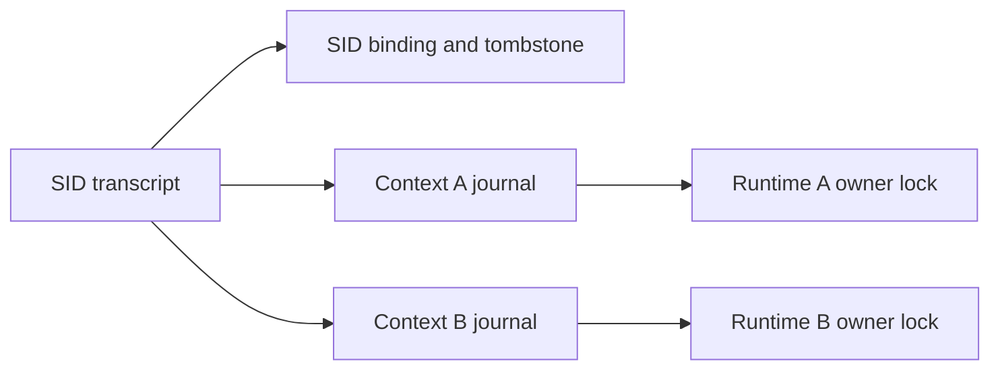

# Agent Communication Protocol

`scode` speaks the **Agent Communication Protocol (ACP)** natively, in two
transports that share a single handler chain.

## TypeScript client and MCP bridge

The [shared TypeScript package](../sdk/typescript/README.md) provides the ACP
connection, direct A2A helpers, a standalone stdio MCP bridge and an optional
Codex callback adapter. It can be installed independently of Hydra and uses
the full scode executable. The package guide owns installation, config,
source/checksum receipts and existing-thread handoff limits.

## Transports

```bash
# stdio — for editors, IDE plugins, and CLI orchestrators
scode acp

# WebSocket + embedded Web UI — for browsers and service backends
scode acp serve --port 8080
```

`scode acp serve --port 8080` exposes:

- JSON-RPC over WebSocket at `ws://localhost:8080/ws`
- An interactive Web UI at `http://localhost:8080/`

Both transports share streaming, tool use, elicitation, and permission
prompting.

## Use cases

- **Editor plugins (Zed, VS Code, JetBrains)** speak ACP over stdio.
- **Web apps and dashboards** connect to the WebSocket endpoint or point
  a browser at `/` to use the embedded UI.
- **Automation pipelines and microservices** run `scode acp serve` as a
  long-lived process behind a load balancer.
- **Sub-agents and orchestrators** fan out work to multiple `scode`
  instances over the wire.

## Binding

For local-only use, bind to `127.0.0.1`. For team access, expose the port
behind your own auth proxy.

## Sessions

One `scode acp` process serves **many sessions**. Requests are ordered per
session and independent across sessions:

- Legacy requests on the **same** session (`session/prompt`, `session/setModel`,
  `session/setPermissionMode`, `session/close`) run strictly one at a time,
  in arrival order. Two prompts sent to one session never interleave.
- Requests on **different** sessions run concurrently. In particular, a
  session that is waiting on the user — a pending `session/request_permission`
  or `_scode/ask_user_question` — does not hold up `session/new` or prompts
  on any other session.
- Within one model turn, independent tools and their notifications continue
  while a question or permission request awaits its reply. Those interactions
  share one input queue; they do not serialize independent tool execution.
- `session/cancel` is never queued; it reaches a session mid-turn.
- Model turns resolve paths within their session's workspace scope, including
  on hook workers, so sessions in different directories can run concurrently.
  Setup and legacy slash operations that use the process working directory
  acquire a directory lease while they run.

### Session-owned input delivery

Hosts check `initialize.result._meta.sudocode.inputDelivery.version == 1`
before using `_sudocode/session/input`. This extension shares the CLI's input
coordinator in `engine-core`; hosts forward intent and project state instead
of maintaining another turn scheduler. Unsupported agents keep the ordinary
`session/prompt` path.

Every request includes `sessionId` and an `action`:

| Action | Behavior |
| --- | --- |
| `submit` | Supply a unique `clientId`, ACP text/image `content`, and `delivery: "steer"` or `"queue"`. Optional `display` is the queue preview; optional `draft` is opaque editor metadata returned on recall. |
| `flush` | Make pending input eligible at the next safe model boundary without cancelling the current tool. |
| `flush_or_cancel` | Flush pending input; if there is none, cancel the active turn. |
| `recall` | Return all still-queued human inputs in FIFO order, including content and draft metadata. Peer and task notifications remain queued. |
| `snapshot` | Return the current queue projection without starting a turn. |

`steer` allows delivery at the next model boundary within the active turn.
`queue` waits for the current turn to end. These actions do not interrupt a
running tool to inject text. Idle input starts a new turn automatically.
Cancellation through `session/cancel` always remains available and pauses
unapplied input; an explicit human steer or flush resumes delivery. Delivery
does not add a mandatory instruction to abandon the model's existing work.

Replies carry `state`, with a monotonic `revision`, nullable `activeTurnId`,
`running`, `paused`, and `pending`. Each pending item has an engine-assigned
`id`, `clientId`, `display`, `source` (`human`, `peer`, `background`, or
`subagent`), and delivery intent. Submission replies also carry `id`; recall
replies carry `recalled`; flush replies carry `cancelled`.

`_sudocode/session/input_update` notifications contain `sessionId` and `update`:

- `state` publishes the revisioned projection. Ignore older snapshots, including
  those in delayed request replies.
- `committed` identifies the input whose content entered conversation history.
  Admission alone is not consumption; hosts add user transcript bubbles here.
- `turn_complete` carries the turn ID, stop reason, usage and cumulative usage.
- `error` reports a failed automatic turn.

Normal ACP streaming, permission and question interactions still apply,
including turns started by background completion or peer input. Active native
turns reject destructive lifecycle changes such as session reload or model
switching while leaving queue controls and cancellation responsive. Legacy
clients receive no input-delivery notifications until they use this extension.

Pending drafts and request deduplication live in session memory. A snapshot can
restore a host's view while the engine survives; it is not recovery after engine
exit. On connection loss or an unknown admission outcome, inspect current state
before retrying. Clear request correlation and revision state when the upstream
session is replaced so replies from the old session cannot restore stale input.

The wire types live in `engine-acp/src/input_control.rs`; scheduling and ownership
live in `engine-core/src/session_inputs.rs` and `input_queue.rs`. Acceptance runs
through `cargo test -p rusty-sudocode-cli --test pty_host_input_queue`; setting
`SCODE_TEST_BACKEND=live` exercises the same workflows with the configured model.

### Human takeover of tools

Hosts check `initialize.result._meta.sudocode.toolPause.version == 1` before
offering takeover. Both transports expose the same session extension:

1. Send `_sudocode/session/pause_tools` with `{ "sessionId": "..." }`.
   Admission closes immediately, the current turn is cancelled, and all owned
   background agents and shells receive cancellation. The response is
   `{ "pauseEpoch": 1, "isQuiescent": true }` only after the main turn, child
   producers and actual tool workers have drained. Cancelling a tool's caller
   does not release its worker's operation lease.
2. While the user owns control, new prompts and tools are refused. Reloading the
   live session cannot replace its fence. Prompts queued before the takeover are
   also refused after control changes. A repeated pause retains the same epoch.
3. Send `_sudocode/session/resume_tools` with the same `sessionId` and
   `pauseEpoch`. A stale epoch or unfinished work is refused. The response is
   `{}`. Returning control permits a new turn; it does not restart cancelled work.
4. The host starts a new turn that observes the user's changes before taking
   further action. For browser takeover, retain the same browser/profile/tab and
   use the browser service's own lease to fence browser-side operations.

Pause has a 30-second response budget. A timeout preserves the fence and must
remain a visible stopping state; it never acknowledges human control. The host
can repeat the pause request once slow operations have ended. Closing a session
remains available. This contract covers work owned by this agent session;
external processes and independently connected clients need their own control
lease.

The native terminal regression runs in CI on all three platforms:

```bash
cd rust
cargo test -p rusty-sudocode-cli --test pty_tool_pause -- --nocapture
```

With a configured provider account, the foreground shell journey also runs
against the real model in the same native PTY:

```bash
SCODE_TEST_BACKEND=live SCODE_LIVE_MODEL=your-configured-model \
cargo test -p rusty-sudocode-cli --test pty_tool_pause \
  host_takeover_stops_a_foreground_shell_before_human_edit -- --nocapture
```

The real model journey starts main and background child shells, pauses them,
checks their file writes stop, rejects stale return, and reads a human edit in a
new turn. It requires explicit real API credentials and an empty evidence path:

```bash
SCODE_TOOL_PAUSE_LIVE=1 SCODE_TEST_BIN=/absolute/path/to/scode \
OPENAI_API_KEY=... OPENAI_BASE_URL=https://your-provider.example/v1 \
SCODE_LIVE_MODEL=your-model \
python crates/rusty-sudocode-cli/tests/live/tool_pause.py --evidence /tmp/pause-evidence
```

### Question descriptions and plan approval

`_scode/ask_user_question` keeps `description` as a string and supplies optional
`descriptionFormat` (`"plain"` or `"markdown"`) when a description is present.
Clients can render model questions and plan reviews as Markdown while keeping
configuration and permission text literal.

Plan approval runs through this same question exchange even when the engine
has no terminal. Selecting “Clear context & execute” continues inside the
engine's current turn after clearing exploration history; the client does not
need to submit a replacement prompt. No answer does not approve execution.

### Cancelling a foreground shell tool

Cancelling a turn terminates the running Bash command's process group, including
its descendants. A Bash tool timeout performs the same cleanup and returns a
timeout result to the model. The model can then finish its reply. Unix uses a
process group; Windows uses a Job Object. The session remains available for the
next prompt after cancellation or timeout.

The live PTY regression in
[`pty_bash_process_tree.rs`](../rust/crates/rusty-sudocode-cli/tests/pty_bash_process_tree.rs)
waits for a real grandchild's file marker, cancels or times out its shell, checks
that the grandchild exits, and asks the next turn to copy the marker's token into
a new file. With Node.js and [proxy credentials](authentication.md) configured:

```bash
cd rust
SCODE_TEST_BACKEND=live SCODE_LIVE_MODEL=claude-sonnet-4-6 \
  cargo test -p rusty-sudocode-cli --test pty_bash_process_tree -- --test-threads=1 --nocapture
```

The `Live Bash process tree` CI job runs this workflow on Linux and Windows for
main pushes and manual workflow runs, using `SUDOROUTER_CI_API_KEY`.

### Direct A2A requests

Hosts check `initialize.result._meta.sudocode.directA2a.version == 1`. Two
session requests run the session's own A2A tools for the client, without a
model turn. `directA2a.errorOutcomes == 1` means every failure carries a typed
outcome, described below.

- `_sudocode/a2a/send` with `{ "sessionId", "to", "message", "summary" }`
  runs the `send` tool. `message` and `summary` are plain text. The session's agent is the
  sender: a `sender` field, a structured message or any other unknown field is
  refused as invalid params.
- `_sudocode/a2a/agent_list` with `{ "sessionId", "activeOnly"? }` runs the
  `agent_list` tool.

Both answer `{ "content": "...", "isError": false }` with the tool's own result,
verbatim. They pass the same gates a model's call does: hooks, the session's
permission mode (a prompt arrives as `session/request_permission`, and a denial
comes back as `isError: true`) and `--allowedTools`. Nothing is written to the
conversation, so the model never sees the call.

A direct request never waits: if the session is in a turn or another request,
or its tools are paused, it is refused before anything runs. `isError: true`
reports a failed call; it does not prove that nothing was delivered, so do not
retry it blindly.

`directA2a.errorOutcomes == 1` adds a typed refusal contract. Only an error with
code `-32602` and `error.data.sudocode.directA2a` containing
`{ "version": 1, "outcome": "not_submitted" }` attests that the host rejected
the request before tool execution. This includes an unknown session, invalid
params, paused tools, a busy session and a session control change. The reason
is carried in `error.data.detail`. After
admission, driver or response failures use `-32603` with top-level
`error.data.outcome: "unknown"` and matching versioned phase metadata. A
cancelled call never returns a partial tool result as if final. Generic
JSON-RPC errors without the advertised contract, opaque
`isError` results, timeout and disconnect do not prove that no append occurred.
Keep the original request for reconciliation; do not retry or fall back to a
prompt automatically.

`directA2a.hostAudit == 1` adds
`result._meta.sudocode.directA2a.audit`: version, unique `commandId`, native
`sessionId`, actual executor mailbox `actor` and `namespaceRoot`, tool,
`requestedInputSha256`, optional `effectiveInputSha256` and `resultSha256`.
The first hash binds the requested fields before hooks; the effective hash is
present only after the real executor has validated the rewritten invocation.
The result hash binds content and `isError` before adding metadata. The host checks the
effective call after hooks against its actual mailbox and unique command ID;
hooks cannot insert a sender override or structured control message, change
tools or dispatch a shadowing MCP tool. A plain text rewrite still uses the
ordinary scheduler, hooks, policy and real executor.

Audit metadata is returned on this connection, separate from model history; it
is not a durable journal or a delivery receipt. An empty namespace root denotes
the daemon's logical namespace, not proof of a healthy connection or verified
remote identity. The receiving node's authenticated envelope is the independent
identity evidence. Hosts retaining an audit must save the native result and
its call ID themselves, without putting a fabricated model tool call into the
transcript. `hostAudit:1` is specifically metadata on a returned tool result,
including an opaque `isError` result. A driver exception, cancellation without
a result, or transport loss may have no audit receipt; `-32603` still means
Unknown and does not promise command/actor correlation. There is no all-command
provenance claim. Inspect the real node envelope to reconcile an uncertain
append.

Hash encoding is independent of JSON property order and has no Unicode
normalization. `frame(x)` means an unsigned 64-bit big-endian byte length,
followed by UTF-8 bytes. Digests are SHA-256, lowercase hexadecimal:

```text
input:  ASCII("sudocode.direct-a2a.input.v1") || NUL || frame(tool)
        || u64be(number of fields)
        || for each ASCII field name in sorted order:
             frame(name) || type || value
        string: type=1, value=frame(text)
        false:  type=2, no value bytes
        true:   type=3, no value bytes
result: ASCII("sudocode.direct-a2a.result.v1") || NUL
        || one byte (isError ? 1 : 0) || frame(content)
```

Input fields use native tool names: `to`, `message`, `summary`, or
optional `active_only`. Omitted and false are distinct. No audit field or RPC
`sessionId` participates in those hashes; native session/actor remain separate
audit fields. The public schemas bound the field count and types. A hook's
effective hash does not disclose its body; the real envelope is needed to
verify the final recipient and text.

Direct calls share the session's operation registry, including the lease held
by an actual blocking Node worker. Cancelling the scheduler does not stop that
worker immediately. `pause_tools` acknowledges quiescence only after the worker
has drained; a timeout keeps the fence. An accepted append can still become
visible at the node after the caller loses its ACP reply.

The normal stdio tests check typed refusals, hook rewriting, mailbox binding
and absence from model history. `e2e/nexus-a2a/run.sh` also runs
`acp_direct_fences::live_direct_a2a_*` against its isolated real TLS daemon:
opaque TCP traffic is held while pause cancels a request, and a post-execution
hook withholds a reply while the node already holds the message. Their model
endpoint refuses every inference request and must record zero calls. This is
not a cross-host idle callback or production deployment acceptance.

### Closing a peer session

When the last session for an agent closes, the server stops and joins that
agent's real receiver worker before replying to `session/close`. Closing one
of several sessions keeps the shared receiver running. A replacement receiver
waits for a retiring worker rather than treating its stop signal as completed
cleanup. The join includes the worker's lock-release attempts; a failed remote
unlock can still require backend TTL recovery. This changes no lease, cursor,
delivery acknowledgement or retry policy.

### Per-session system prompt (`_meta.sudocode.*`)

`session/new` and `session/load` accept two optional, orthogonal keys under
the request's `_meta.sudocode` object. Both are plain strings, passed to the
model verbatim — no truncation, no escaping, no size cap beyond the model's
own context window, and no policy about who may use which: that is the
caller's (e.g. a multi-tenant service's) decision.

```json
{
  "cwd": "/work/tenant-a",
  "mcpServers": [],
  "_meta": {
    "sudocode": {
      "systemPrompt": "You are Tenant A's release bot. ...",
      "appendSystemPrompt": "House rules: never push to main. ..."
    }
  }
}
```

| Key | Effect |
|---|---|
| `systemPrompt` | **Override.** Replaces the built-in static system-prompt blocks (the `You are Sudo Code…` identity, `# System`, `# Working`, `# Risky actions`, `# Tools`, `# Git`) with this text as the single static block. |
| `appendSystemPrompt` | **Append.** Added as the last **static** block, after the built-in identity and behaviour blocks and before every dynamic block (environment / project context, `AGENTS.md` instructions, runtime-config summary, auto-memory, plugin inventory, skill listing). A caller preamble is stable for the life of the session, so it belongs in the aggressively cached prefix; the cost is that the workspace-derived dynamic blocks now follow it rather than precede it. |

The two compose: set both and the static blocks are replaced *and* the
extra block is appended after the replacement, still inside the static
prefix. Workspace-derived dynamic blocks (environment,
`AGENTS.md`, memory) are always kept, so an overridden prompt still knows
which directory it is operating in.

Rules:

- A present key must be a non-empty string; an empty/whitespace string or a
  non-string value is rejected with `invalid_params` (`-32602`) rather than
  silently ignored.
- The values are bound to the session for its whole lifetime — a
  `session/setModel` rebuilds the runtime with them re-applied. They are
  **not** persisted with the transcript; a client that wants them on a
  resumed session passes them again on `session/load`.
- They layer on top of the process-wide `--system-prompt` /
  `--append-system-prompt` CLI flags of the `scode acp` process, if any:
  a session `systemPrompt` replaces whatever the process default static
  block is, and a session `appendSystemPrompt` is appended after the
  process-level append.
- The `initialize` response advertises `_meta.sudocode.systemPromptOverride:
  true` and `_meta.sudocode.systemPromptAppend: true` so clients can
  feature-detect.

### Per-session memory (`_meta.sudocode.memory`)

`session/new` and `session/load` accept an optional `memory` key under
`_meta.sudocode` that decides whether **this one session** uses the
persistent memory system (`~/.scode/projects/<slug>/memory/`, or wherever
`SUDOCODE_MEMORY_DIR` points).

```json
{
  "cwd": "/work/tenant-a",
  "mcpServers": [],
  "_meta": {
    "sudocode": {
      "memory": "disabled"
    }
  }
}
```

| Value | Effect |
|---|---|
| *(key absent)* | **The default.** Memory behaves exactly as it always has — the auto-memory block is part of the system prompt and the model may write entries. A client that never sends the key sees no change. |
| `"enabled"` | The explicit spelling of the default. |
| `"disabled"` | This session neither reads nor writes memory: no auto-memory block in its system prompt (so the model is never told the memory directory exists), and the standing permission to write under that directory is not granted. |

Rules:

- **Session-scoped, not process- or user-scoped.** One `scode acp` process
  serves many sessions and each carries its own mode: session A can remember
  while session B, in the same process and the same directory, does not.
- **Disabling stands memory down; it never deletes.** Nothing under the
  memory directory is read, written, moved or removed — a disabled session
  does not even create the directory. Open a later session without the key
  (or with `"enabled"`) and the same entries are back.
- The mode is bound to the session for its whole lifetime: a
  `session/setModel`, an automatic compaction or any other runtime rebuild
  re-applies it. Like the system-prompt keys it is **not** persisted with the
  transcript — a client that wants a resumed session to stay memory-less
  passes the key again on `session/load`.
- A value outside `"enabled"` / `"disabled"`, or a non-string value, is
  rejected with `invalid_params` (`-32602`) rather than silently ignored.
  Trimming aside, matching is exact and case-sensitive: `"off"`, `"Disabled"`
  and `false` are all errors. Silently defaulting a mistyped value to
  "enabled" would leave memory on while the caller believed it off, which is
  the one failure this key must not have.
- Sub-agents a turn spawns keep their own per-agent-type memory
  (`agent-memory/<type>/`, a different directory) and are **not** covered by
  this key today.
- The `initialize` response advertises `_meta.sudocode.sessionMemory: true`
  so clients can feature-detect.

### Model turn usage

The prompt response reports provider token usage when available. Input, output,
cache and cost fields may arrive in separate stream frames; the shared engine
merges those cumulative snapshots before recording the assistant message and
returning ACP usage. Counts are never inferred from answer length. The same
merge rule serves collected responses and the terminal renderer.

A provider may report a nonzero aggregate without allocating it to input or
output tokens. The normalized usage retains this as `reported_total_tokens`,
through saved sessions, resumed sessions and cumulative accounting. Totals use
the larger of the reported aggregate and known allocated counts; allocations
are never guessed. ACP adds `_meta.sudocode.tokenBreakdownComplete: false` when
the allocation is incomplete; complete usage retains its existing wire shape. CLI JSON
exposes `token_breakdown_complete` alongside `total_tokens`. With an incomplete
breakdown, context occupancy falls back to the history estimate, and estimated
cost is unavailable (JSON `null`); an independently reported actual bill remains
usable. [OpenAI prompt counts include cached tokens](https://developers.openai.com/api/reference/resources/chat/subresources/completions/streaming-events), so normalization removes
the cache breakdown from the uncached input count before aggregation.

OpenAI-compatible streams finish at `[DONE]` (Chat Completions) or a terminal
`response.*` event (Responses). A completed SSE message does not wait for the
HTTP connection to close; usage frames before its terminal event are retained.

### Slash commands

A `session/prompt` whose text starts with `/` is a slash command, not a model
turn: it runs on the session's lane like any prompt, streams its result as
`agent_message_chunk` text, and completes with `stopReason: "end_turn"` and
no `usage`. The ACP agent implements a fixed subset of the REPL commands:

| Command | Effect |
|---|---|
| `/help` | List the commands in this table (the REPL-only ones are not shown). |
| `/status` | Model, usage, git and config status for this session. |
| `/cost` | Cumulative token usage for this session. |
| `/model [<model-id>]` | Show the current model, or switch this session to another model. |
| `/compact` | Summarise older messages to free context under the strict compaction contract below. A successful replacement meets both the history-reduction target and the next-request budget, is persisted immediately, and archives the original transcript. An unchanged achieved target or safe history with nothing summarizable can skip. The reply reports the outcome, method, estimated history before / after and target; the structured report also includes request attempts. Failure preserves message history and returns an error; known maintenance usage is still recorded. |
| `/config [section]` | Show the effective configuration (read-only; `/config set` is REPL-only). |
| `/diff` | Staged and unstaged git changes in the session directory. |
| `/doctor` | Local health checks for auth, config and workspace. |

Any other `/command` is answered with a one-line text hint naming the command
and listing this table.

**Discovery.** Right after a successful `session/new` or `session/load`
response, the agent sends one `session/update` notification advertising the
table, so clients can build a command palette without hard-coding it:

```json
{
  "jsonrpc": "2.0",
  "method": "session/update",
  "params": {
    "sessionId": "…",
    "update": {
      "sessionUpdate": "available_commands_update",
      "availableCommands": [
        { "name": "compact", "description": "Summarise older messages to free context (validated LLM checkpoint)" },
        { "name": "model", "description": "…", "input": { "hint": "<model-id>" } }
      ]
    }
  }
}
```

Names carry no leading slash; send them as `/name …` in `session/prompt`.
`input.hint` is present only for commands that take arguments. The
notification follows the response on the same connection, so the client
already knows the session id when it arrives; be ready to receive
`session/update` for a session as soon as its `session/new` response is in,
because this one follows immediately. The same table drives `/help` and the
unknown-command hint, so the three never disagree.

`session/cancel` applies to `/compact`: cancellation before the durable commit
stops the pending call or discards its staged candidate, preserves the original
message history, and ends the prompt with `stopReason: "cancelled"`. The runtime
finalizes any usage already received before returning, so maintenance metadata
can change even though message history does not. A completed durable commit
wins over a later cancellation. The other commands are local and complete
before a cancel could matter.

**Live compaction lifecycle.** Before manual or automatic context maintenance,
`session/update` emits a standard ACP `tool_call` with title `context_compaction`,
kind `other`, status `in_progress`, and a unique `toolCallId`. This is an
engine-owned operation, not a tool registered with the model. `rawInput` carries
`trigger` (`manual`, `preflight`, `in_turn_budget`, `provider_rejection`, or
`post_turn_usage`) and `before_tokens`. Completion emits `tool_call_update` with
the same ID, status `completed` or `failed`, and `rawOutput` containing `id`,
`trigger`, `status` (`completed`, `failed`, or `cancelled`), `before_tokens`,
optional `after_tokens`, and an optional structured `report`. Counts are
estimates; summary text is never included. Cancellation uses ACP status
`completed` with `rawOutput.status: "cancelled"`. A skipped run also uses ACP
status `completed`; `report.outcome` distinguishes it from a committed result.
Every terminal update is delivered before the prompt response, including error
responses. A failed compaction ends the prompt with an error; clients must mark
the run failed. The completed operation remains available for client replay.

**Compaction contract.** A replacement is accepted only when the estimated
tokens of the complete resulting history are at most
`min(50% of the original history, safe history budget for the next request)`.
The ideal is 30% of the original history, bounded by that same target. The
complete history includes the checkpoint, continuation framing, Todo state and
protected recent tail. The safe history budget reserves the routed model's
output allowance, actual system prompt and selected tool schemas, pending input
and pressure buffer. These are local estimates, not tokenizer guarantees; a
provider context rejection still requires recovery or a failed prompt.

The visible summary ceiling is computed from the remaining target after
protected history and framing, capped at 12,000 tokens and the model's available
output limit. Budgeted thinking is reserved separately before choosing that
visible ceiling; adaptive thinking adds no manual thinking reservation. The
ceiling can therefore be much smaller than 12,000; fitting
the summary alone is insufficient if the complete history misses the target.
No partially reduced candidate is installed.

All summary paths and retries in one run share limits of two completed model
responses, four actual model HTTP attempts and two transient-error retries.
Local budget checks and token estimates do not consume HTTP attempts. Provider
transport retries do not add a separate allowance. A quality retry starts from
the same frozen source, protected tail and Todo state; it does not summarize a
rejected candidate. Permanent provider errors stop the run. Cache-preserving
compaction can switch to the fallback for a context overflow, a typed
unsupported-path error, or a completed checkpoint whose truncation or visible
ceiling requires a quality retry. A generic authentication or configuration
failure does not qualify.

The report's `outcome` is `target_met`, `skipped`, `failed` or `cancelled`.
`target_met` means the accepted complete history meets the bound. `skipped`
can mean a previously achieved target remains safe with an unchanged
history/context/configuration/tools/budget fingerprint, or there is no
summarizable source and the existing history is safe. A provider-rejection
recovery does not use those skips. Failed and cancelled runs preserve message
history; rejected or cancelled candidates are not installed or archived.

The optional `report` contains:

| Fields | Meaning |
|---|---|
| `run_id` | The same ID as the enclosing progress `id` and ACP `toolCallId`. |
| `before_history`, `after_history` | Estimated complete history before and after the run. |
| `target_history`, `ideal_history` | Acceptance bound and preferred target; null for a skipped run. |
| `source_safe_history_budget`, `safe_history_budget`, `actual_fixed_overhead` | Source and final next-request history budgets, and the final estimated system/tool overhead. |
| `method`, `outcome`, `reason` | Selected method, result and diagnostic reason. |
| `attempts`, `completed_responses` | Actual model HTTP sends and completed model responses in this run. |
| `estimate_source` | Estimator identity, currently `local_history_estimate_v1`. |

Maintenance usage receipts are keyed by run and actual request attempt. Known
usage is counted once in cumulative session usage and cost, including usage
received before a failed or cancelled response. It is persisted as optional
session metadata and restored on load; an unknown receipt remains unknown.
Maintenance usage does not become the current task's usage, add a task turn or
set the context anchor for the next task request. Metadata persistence failures
are reported. If the durable source changes, its newer history is preserved and
any receipts that could not be saved remain in memory.
Capturing a revision also merges durable maintenance receipts from the same
snapshot, so externally added bills survive unchanged-history compaction.
An unreadable or unreloadable source prevents stale persistence during exit or
later operations until a successful reload restores the session.

**Automatic compaction.** When a turn compacts the transcript on its own —
either the pre-turn overflow guard or the in-turn threshold path — the
`session/prompt` response carries `_meta.sudocode.autoCompacted: true`
alongside the existing `contextWindowTokens`, `estimatedSessionTokens`,
cost and `cumulativeUsage` fields. The key is absent when no automatic
compaction happened; `/compact` itself never sets it (its report is the
text reply). Like the rest of `_meta.sudocode`, it rides on the success
response, so a turn that fails after compacting reports the error and no
`autoCompacted`.

The policy borrows rolling checkpoints, token-priced retention and prune-first
pressure handling from [DeepSeek Harness](https://github.com/deepseek-ai/deepseek-harness/blob/c291e7961a515f6d7af9304e7fd1d257929aef26/docs/subsystems/compaction.md).
Sudo Code retains its model-specific output reservation and pressure buffer.

Compaction stages changes before replacing the live transcript. An empty,
truncated, or non-shrinking summary, or a candidate that misses the complete
history target, is rejected. Failure before or during a turn stops the pending
model request with message history intact. Post-turn compaction
failure also fails the prompt, even if answer text has already streamed; it must
not report a successful run or continue queued work. No automatic
local-statistics fallback is used. The next request cannot proceed when its
history still exceeds the context budget.

Automatic pressure first trims oversized tool text (over 8,192 Unicode code
points) to a 4,096-point head and 1,024-point tail plus a marker. ToolSearch
results are exempt because their JSON also enables deferred tool schemas.
If trimming meets the complete-history target, no summary call is made.
Otherwise the same checkpoint pipeline as manual compaction runs. A checkpoint
rewrites prior summaries
with newer history instead of concatenating them. Recent retention is token
priced: at most 16% of the model window, capped at half the available history
budget and one fifth of current history, with a four-message minimum and
complete tool exchanges taking precedence. File contents are not re-read and
re-injected after compaction.

Main-agent and subagent clients use the same non-streaming text transport in
`api::ProviderClient::complete_text`. Client adapters select only their model
and tool schemas; runtime owns compaction prompts, retry policy and validation.
The shared transport also owns message conversion and cache hints.

Both LLM paths use the dynamic visible summary ceiling above and ask for the
ideal size, up to 8,000 tokens, where possible. The preferred path reuses the
system prompt, tool schemas and older message prefix, with a separate model
thinking reservation where required; the fallback strips thinking and replaces
images with text placeholders. Neither path drops the oldest input to recover
from overflow. Transient failures use bounded backoff within the shared run
limits.

Only the final accepted candidate is committed. Run preparation replays the
durable source and requires its message history to match the frozen source
before capturing that revision. Before any archive or replacement, the
filesystem backend checks the captured revision again. An observed source
change fails the run and preserves the newer transcript. These checks are not
a cross-process compare-and-swap or lock.
On successful replacement, `<transcript>.before-compact-<timestamp>` retains
the original JSONL snapshot through the same filesystem backend. These
snapshots are not listed as independent sessions and are not automatically
pruned. The current transcript is replaced atomically before memory changes;
a subsequent load therefore sees the committed checkpoint. This is snapshot
preservation, not a new event-sourced session format.

### `session/load`

`agentCapabilities.loadSession` is advertised. `session/load
{sessionId, cwd, mcpServers}` re-opens a session persisted by an earlier
process from `<cwd>/.scode/sessions/<workspace-fingerprint>/<sessionId>.jsonl`
and the next `session/prompt` continues the conversation with the full prior
transcript (user turns, assistant turns, thinking, tool calls and tool
results) sent to the model.

What is restored is the **transcript**: message history, the session's model,
compaction state and fork lineage. What is not: in-memory turn state such as
a permission mode set through `session/setPermissionMode` (the loaded session
starts from the configured default again), per-turn "allow always" answers,
running background commands, and MCP servers other than the ones passed in
the `session/load` request.

`cwd` must be the directory the session was created in — a session's store
is keyed by its workspace and the persisted `workspace_root` is validated on
load, so loading a session id from another directory is rejected. Continuing
a conversation in a new directory is a fork, not a load — see `forkFrom`
below. `session/load` does not currently replay the history to the client as
`session/update` notifications; the client is expected to keep its own copy
of the conversation.

### Forking a conversation (`session/new` + `_meta.sudocode.forkFrom`)

A client that branches a conversation — "continue from here in a new
session" — creates the branch with `session/new` and names the source under
`_meta.sudocode.forkFrom`. The new session starts as a **copy of the source's
transcript** (messages, compaction state, model, prompt history), gets a
fresh id, records the source as its parent, and is persisted under the new
`cwd`'s own session store, so it is a first-class session there (later
`session/load {cwd}` of it works). The source is read, never modified.

```json
{
  "cwd": "/home/user/session-b",
  "mcpServers": [],
  "_meta": {
    "sudocode": {
      "forkFrom": { "sessionId": "session-1788512053256-0", "cwd": "/home/user/session-a" }
    }
  }
}
```

`forkFrom` takes `sessionId` and/or `cwd`:

| Given | Source |
|---|---|
| `sessionId` only | A session **open in this process**. Rejected (`invalid_params`) if it is not — after a restart pass `cwd` as well. |
| `sessionId` + `cwd` | The session persisted under `cwd`'s store, validated against its recorded workspace root exactly like `session/load`; an open session of that id must live in `cwd`. |
| `cwd` only | The most recently updated session persisted under `cwd`. Useful for a client that keeps one directory per conversation and does not track scode's session ids. |

An open source is copied from memory when it is idle; mid-turn (a turn holds
the session for its duration) the persisted transcript is copied instead,
which carries every completed message. Offloaded tool results referenced from
the transcript are copied alongside it. The copy is the whole transcript —
there is no point-in-time cut yet.

`forkFrom` composes with `systemPrompt` / `appendSystemPrompt` on the same
request; a present-but-malformed `forkFrom` (not an object, neither field,
empty strings) is `invalid_params`. The `initialize` response advertises
`_meta.sudocode.sessionFork: true` so clients can feature-detect. Older
agents ignore the key and start an empty session, which is the behaviour
the flag lets a client avoid relying on.

### Sub-agent events (`clientCapabilities._meta.sudocode.subagentEvents`)

A sub-agent (`agent_spawn` / `Agent` / `pid_fork`) runs its own conversation
inside the same `scode` process. By default the client sees only the
spawning call (`tool_call` + one `tool_call_update`); in background mode that
update arrives at once with `rawOutput.status: "running"` and no result. A
client that wants to show what the sub-agent is doing opts in at
`initialize`:

```json
{ "protocolVersion": 1,
  "clientCapabilities": { "_meta": { "sudocode": { "subagentEvents": { "version": 1 } } } } }
```

scode then echoes `result._meta.sudocode.subagentEvents = {"version": 1,
"cancel": true}`. **Without the opt-in nothing changes — the `initialize`
result included** (`acp_subagent_events_off_matches_pre_contract_output`
compares the wire against fixtures captured before this existed). The opt-in
is per connection and applies to the sessions that connection creates or
loads.

With it, every sub-agent's text, thinking, tool calls and tool results are
sent as ordinary `session/update`s **on the parent's `sessionId`**, and two
keys under the update's own `_meta.sudocode` tell them apart:

| Key | Meaning |
|---|---|
| `subagent: {parentToolCallId, agentId, seq}` | This update belongs to that agent's stream. `seq` runs from 0 per agent, without gaps, shared with the agent's lifecycle. |
| `agentSpawn: {agentId?, name, description, subagentType, model, color, background, lifecycle?}` | This call spawns an agent. `agentId` is absent on the `tool_call` itself (the agent does not exist yet). |

- A sub-agent's call ids are `<agentId>:<raw id>`, so they never collide with
  the parent's or a sibling's.
- A nested spawn (a sub-agent's own `agent_spawn`) carries both keys; its
  grandchild's `parentToolCallId` is that namespaced call id.
- Each agent gets two **lifecycle** updates on its spawning call — status-less
  `tool_call_update`s with `agentSpawn.lifecycle.phase` `started` and
  `finished`. `finished` carries `lifecycle.status` (`completed` / `failed` /
  `cancelled`), `startedAt` / `completedAt` (the manifest's Unix-seconds
  strings) and, as `rawOutput`, the final agent manifest with the result text.
  A background agent's stream and `finished` may arrive after the
  `session/prompt` response; they go out on the connection that last prompted
  the session, and stop once the session is closed.
- `_sudocode/agent/cancel {sessionId, agentId}` stops one running agent this
  session reported `started` for (the same abort a
  `SendMessage(shutdown_request)` fires; it does not cascade to agents it
  spawned) and answers `{cancelled}`; its `finished` then says `cancelled`.
  Any other agent id, or a session without the opt-in, is `invalid_params`.
- Sub-agents inherit the parent's permission mode. A child tool that requires
  approval sends `session/request_permission` through the parent's controller
  connection and waits for its answer. A missing approver denies the call.

## Durable direct sub-agent completions (extension v1)

One SID can have several concurrent runtime contexts. Transcript appends retain
stable message identities and parent references; each runtime continues its own
context. See the [shared-session storage contract](design/agent-context-storage-matrix.html#shared-session-context).

The v3 completion layout stores the SID binding and deletion tombstone in
`transcript.completions.json`, and each context's journal in
`transcript.completions/<context-id>.json`. A short native OS lock serializes
commits. A separate OS owner lock holds each live context; a new runtime opens
another context while that owner is alive. Cold recovery resumes a journal at
the nearest matching ancestor after its owner exits. Neutral checkpoints retain
that ancestry, so cold recovery preserves completion receipts and context
revisions. Tool sources are keyed by
the originating assistant message identity and provider call ID.



Opening v2 storage preserves its durable facts before publishing the v3 binding
under the commit lock. An older writer encountering this binding reports a
protocol mismatch. Unversioned v1 journals return `legacy_writer_unconfirmed`
with their original bytes preserved. Protocol negotiation remains extension v1,
independent of the storage version. Backends advertise the extension when they
provide this ownership and commit contract.

A controller opts in on each connection with
`initialize._meta.sudocode.subagentCompletions: {"version":1}`. The server
advertises the same version only on runtimes that implement the journal and
exact-context contract. Without negotiation, existing ACP behavior is unchanged.
`subagentEvents` remains the display stream. This extension covers only children
spawned directly by the top-level ACP session; nested children and background
shell/Monitor jobs do not receive an automatic-continuation guarantee.

Each opted-in `session/prompt` supplies `_meta.traceId`. Before starting a child,
scode durably registers its agent ID, spawning tool call and trace in a journal
beside the parent transcript. Shared CLI/ACP reduction requires actual
`running`/`backgrounded` handoff, a persisted terminal manifest, and the committed
parent turn. A canonical `pid_output` read suppresses an unpublished candidate.
A synthetic abort without terminal evidence cannot publish a completion.
If recording a terminal event fails temporarily, the existing delivery loop
retains its bounded lifecycle data and retries the journal write. Delivery still
waits for the parent commit and honors explicit result collection. A process
restart recovers the terminal evidence from the persisted child manifest.

The agent sends a JSON-RPC **request** `_sudocode/subagent/completed`:

```json
{"sessionId":"session-id","completionId":"64 lowercase SHA-256 hex characters",
 "agentId":"agent-id","parentToolCallId":"tool-call-id","originTraceId":"run:prompt",
 "status":"completed","message":"<task-notification>...</task-notification>"}
```

Status is `completed`, `failed`, or `cancelled`. The message uses the existing
XML-escaped tool-result renderer, bounded to 64 KiB UTF-8 before delivery. It is
untrusted tool output, not a system instruction. Completion identity is derived
from version/session/tool/agent; payload freezes before the first send. Publication
is the deduplication cutoff: a later explicit read cannot retract an in-flight
receipt. This does not promise exactly-once model execution.

The controller replies only after committing its durable receipt:
`{"completionId":"…","disposition":"stored"}`. A previously verified binding
whose session has been deleted may instead reply
`{"completionId":"…","disposition":"discarded","reason":"session_deleted"}`.
Delivery is sequential per session in durable publication order, outside
engine/prompt locks. An earlier spawn finishing late cannot overtake an
unacknowledged publication, including after restart. Transient errors
and missing ACKs retry the identical payload with bounded exponential backoff;
invalid requests or inconsistent ACKs quarantine that item. Method-not-found and
authentication-required suspend delivery until a fresh binding. Replies from a
retired binding cannot stop the replacement delivery. ACK persistence failure
leaves the item pending. ACK tombstones retain identity, releasing result text;
journals stop accepting additions at 10,000 registered children or 64 MiB and
report `completion_journal_capacity` rather than silently dropping work.

`_sudocode/subagent/replay {sessionId,cwd}` reads only the exact journal,
transcript and registered child manifests. It does **not** load engines, MCP or
plugins, restart children, scan unrelated cwd results, or run a model. It binds
pending deliveries and returns `{watermark,waiting,pending,unresolved,settled,
blocked,contextRef}`. Missing terminal evidence is `execution_unconfirmed`;
uncommitted parent evidence is `source_context_unconfirmed`. After an interrupted
parent, a new explicit human turn may proceed, but cannot retroactively publish
that parent's unproven completions.

An opted-in prompt's committed response and `session/load` expose
`_meta.sudocode.contextRef = {sessionId,revision,digest,lastTraceId}`. The digest
covers the recoverable context projection. Appends by another context preserve
that projection. Live load validates exact cwd and rebinds
without replacing the engine; cold load opens the exact stored session. A
controller sending an automatic input supplies `_meta.sudocode.expectedContext`.
The agent checks it inside that session's prompt lane before any model work;
mismatch returns `-32602` with `context_mismatch`. Transcript edits/compaction that
invalidate the recorded digest cannot be presented as exact recovery. Hosted
factories do not advertise this extension until they implement its storage contract.


## Direct background terminal completions (task extension v1)

Controllers negotiate `initialize._meta.sudocode.taskCompletions: {"version":1}`.
When both completion extensions are offered, the server selects task completions
only. This uses the same journal, sender and receipt reduction as sub-agent v1;
sub-agent IDs, frozen messages, order and receipt hashes remain unchanged.
Storage ownership follows the [completion storage contract above](#durable-direct-sub-agent-completions-extension-v1).

`_sudocode/task/completed` is a JSON-RPC request. Sub-agent payloads replace
`agentId` with `kind: "subagent"` and `taskId`. Terminal payloads are:

```json
{"sessionId":"session-id","completionId":"64 lowercase SHA-256 hex characters",
 "kind":"terminal","taskId":"shell-random-id","parentToolCallId":"tool-id",
 "originTraceId":"run:prompt","status":"failed",
 "terminal":{"shell":"bash","scope":"command","exitCode":7,"signal":null,
 "termination":"exit","outputTruncated":false},
 "message":"<task-notification>...</task-notification>"}
```

`shell` is `bash` or `powershell`; `termination` is `exit`, `signal` or
`cancelled`. A terminal source must have been registered before spawn, returned
an actual background handle and supplied observed exit evidence. A parent turn
must commit before delivery. Synchronous commands return their ordinary tool
result and never enqueue a completion. Nested shells do not directly notify the
top-level parent. Explicit result collection suppresses an unpublished result.
The ACK contract is the same as sub-agent v1.

The durable terminal snapshot keeps a UTF-8 output tail of at most 24 KiB. The
entire encoded terminal completion is bounded to 64 KiB, including XML escaping,
JSON escaping, identity and metadata. Rendering truncates only output text and
sets `outputTruncated`; frozen payloads and IDs are stable on retry.

All control operations require the original absolute `cwd` and `sessionId`.
`_sudocode/task/replay {sessionId,cwd}` without `storageRef` is a read-only binding
probe returning `{sessionId,storageRef,deleted}`. It neither starts a delivery nor
creates a journal. Use that exact reference with subsequent operations:

- `replay {sessionId,cwd,storageRef,afterTaskId?}` rebinds delivery without loading
  an engine and returns the common counters and context plus `storageRef`,
  `running`, `executionUnconfirmed`, `taskSetHash`, `terminalSources` (up to 50)
  and `nextTaskId`. No PID attachment, process restart or command execution occurs.
- `suppress {sessionId,cwd,storageRef,originTraceId}` requires a closed trace. Its
  ACK is `{disposition:"suppressed",originTraceId,storageRef,watermark}`. Repeating
  a no-op suppression preserves the committed watermark. Suppression closes
  delivery eligibility, including sources without a result; it does not kill
  execution or remove unknown execution facts.
- `purge {sessionId,cwd,storageRef,cleanupId}` requires no active prompt. Its ACK
  is `{disposition:"purged",cleanupId,storageRef}` after writing a minimal deleted
  binding. It retires cached results and fences all late writes. It does not
  remove the transcript, child manifests, project files or original full logs.
  Native session deletion additionally removes its transcript and offloaded
  tool results after committing the same tombstone.

Transcript saves, compaction, journal writes, ACKs and deletion use the
[same commit and context ownership contract](#durable-direct-sub-agent-completions-extension-v1).
Purge checks other native transcript writers and completion context owners. It
reports `session_writer_busy` while another writer is alive, including CLI
instances that have no completion extension. Native writer presence is an OS
lock; a crashed writer's free locator does not assert liveness. The committed
SID tombstone fences subsequent transcript and journal writes. Context lock
files retain stable paths for exclusion.
A temporary storage error retains the bounded exit snapshot for
retry; a process loss before that snapshot was saved becomes
`execution_unconfirmed`, even if its child later exits. Uncertain process creation
or cancellation also cannot be presented as terminal evidence. Never rerun such
a command automatically. Recovery covers reconnects and process restart, not
power-loss durability.

The task extension retains each migrated sub-agent source, frozen payload,
publication ordinal, ACK and context. Protocol capability negotiation controls
which completion payloads the controller can handle; the storage binding
controls writer compatibility.
