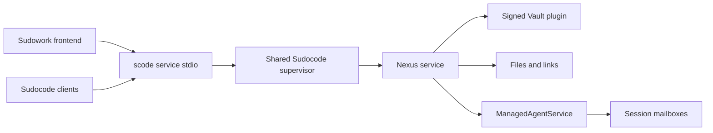

# Shared local services

Sudocode owns the local Nexus service used by its frontends. Each OS user has one
supervisor in a service root. The default root is `~/.nexus-vfs`;
`SCODE_SERVICE_ROOT` selects an absolute root for a container or an isolated test.

The CLI offers runtime selection on its first interactive launch with a fresh
configuration home. Single-agent mode skips Nexus setup. Multi-agent mode first
reuses the Box configured in `~/.nexus/run/node.json`. If no Box is configured,
it prepares local services using the same supervisor and verified artifact
installer as SudoWork. Existing
configuration homes keep their current behavior until explicit setup:

```sh
scode setup --mode local
scode setup --mode shared
scode setup --check --output-format json
```

The preference lives in the CLI's configuration home, while service lifetime
remains owned by the OS-user supervisor. Selecting local does not stop services
used by another frontend. Inspection installs and starts nothing. ACP, service
stdio, headless commands and resume do not display the onboarding picker.
`shared` selects multi-agent mode. A configured Box takes precedence even if it
is temporarily offline or the new Agent still needs credentials: setup never
replaces that choice with a second local service. Malformed records report their
original validation error. Setup preserves the record and its credential bundles;
the normal session connection checks this Agent's own credentials and the Box's
TLS identity. Finding a record alone is not successful authentication: inspection
reports `agentAuthentication:pending`, and setup reports `domainJoinAccepted:false`.
Cross-domain enrollment and participant authorization remain separate. Agent
attachment does not add a Nexus node or change Raft voter membership. Automatic
discovery currently means the saved machine connection, not untrusted LAN peers.

CLI release discovery and explicit `scode update` already share one installer.
An updated CLI does not silently restart the shared Nexus service: setup refuses
a running service with a different native Nexus version. Service transitions
continue through the lifecycle owner's explicit drain/upgrade operation.

## Recover an existing local Box

A machine connection record does not grant process ownership. Remote Boxes keep
their existing owner. To make a manually operated local Node recoverable, its
operator registers a private, resume-only declaration once:

```sh
scode service register-local-box --config /absolute/path/owner.json --owner-root /absolute/path/box-owner
scode setup --mode shared --owner-root /absolute/path/box-owner
```

Registration starts nothing and refuses an existing profile or a service root
that already has local data. `--owner-root` selects a private lifecycle root for
this Box independently of an existing SudoWork service root. Setup saves that
absolute root with the runtime preference; future startup and setup reuse it
without an environment override. It does not move, delete or change the other
service's data. Omitting it retains the ordinary service-root default. The
version-1 declaration contains these fields:

| Field | Meaning |
| --- | --- |
| `schemaVersion` | `1` |
| `boxEndpoint` | Exact endpoint in the existing client `node.json` |
| `binary`, `binarySha256` | Absolute existing native executable and lowercase SHA-256 |
| `dataDir`, `identityDir` | Separate absolute original persistence directories |
| `nodeId` | Original opaque Node ID, as a decimal string |
| `caSha256`, `certificateSha256` | Original `dataDir/tls/ca.pem` and `node.pem` SHA-256 |
| `localEndpoint` | Numeric loopback address on the Node's existing port |
| `advertiseAddr`, `bindAddr`, `hostname`, `serverName` | Existing native listener and TLS declaration |
| `acceptEnrollments` | Optional existing native enrollment-listener choice; defaults to false |

The native Node ID file contains eight big-endian bytes; it is not a text file.
Registration and every recovery validate the executable, Node ID, TLS pins,
metastore, root Raft storage and every persisted zone's Raft storage. Missing
state is refused rather than initialized. The Node's persisted configuration
decides native resume; the supervisor does not pass `cluster-init`, peers,
tokens, force, insecure flags or caller-supplied Nexus environment settings.
No installation, version transition, client-record publication or credential
mint occurs on this path. A rotated Node certificate requires a new explicit
operator ownership transition rather than silently accepting a changed pin.

After multi-agent selection, fresh interactive startup and interactive
`scode --resume` resume only the registered owner matching the saved Box
endpoint. Resume never offers first-run setup. Protocol/headless entrypoints
do not provision services. A live external owner is authenticated and reused; it
is never killed or replaced. A stopped Node resumes through the same supervisor
and lifetime lock, with an additional lock in its original data directory.
External-owner detection connects to the declared loopback endpoint and
authenticates using the declared TLS configuration, including when the Node
listens on a wildcard address.
Only an explicit connection refusal permits recovery. Connection timeouts and
authentication failures report an error rather than starting a replacement.
Closing the selecting CLI leaves that shared owner running. The broker exposes
only lifecycle status for this profile: it does not turn the Node's privileged
readiness certificate into an Agent file, Vault or session credential. Ordinary
shutdown, restart and installation replacement are refused for this shared-Box
profile. After coordinating a maintenance outage, the local operator can stop
only that owner with `scode service stop-local-box --node-id ID
--binary-sha256 SHA256 --acknowledge-shared-outage`. This command is not exposed
through the frontend process channel. It uses the saved owner root (or an
explicit `--owner-root`) and refuses an external owner, a different
target, or an active managed runtime. It drains broker requests, terminates and
waits for its own Node child, then waits for the supervisor lifetime lock to
release. The result explicitly reports `gracefulRaftDrain:false`: process
termination is not graceful Raft leadership transfer. Coordinating standalone
Agent users and checking the real per-zone quorum remain the operator's task.

This registration supports an existing native authenticated cluster using its
default on-disk storage layout. Cohost/plugin-specific boot declarations need
their product's deployment owner. It is not a new Node admission, a Raft
membership change, OS boot registration or HA qualification.



## Ownership and data

The supervisor retains `run/service.lock` for its lifetime. Clients discover it
through `run/service.json` and authenticate its loopback broker using the
connection token. Closing a frontend closes its process channel; the shared
service continues serving its other clients. An explicit shutdown drains requests
and releases the Nexus child. Managed runtimes keep the service in use.

Startup observes the same lifetime lock while a previous owner drains. A daemon
that loses the lock race exits rather than queueing to become an unexpected
future service. Its frontend reaps it and keeps observing ownership within the
original startup deadline; a vacant lock permits another launch. Authenticated
discovery, not a process exit or lock acquisition alone, establishes readiness.
Discovery is published only once Nexus serves `/` and peer messaging's
replicated prefixes (`/agents` and `/conversations`, from
`a2a::REPLICATED_PREFIXES`). Nexus mounts those as their own zone and loads a
hosted zone only on first access, so readiness makes that first access itself
instead of leaving the load to the first client after a restart. A prefix this
node does not mount is absent, so there is nothing to wait for. Each check is a
local read, so a peer being down cannot hold readiness back.

`data/` holds durable Nexus and Vault content. `identity/` holds the service's
transport peer and zone membership identity, scoped to the same managed root.
`run/` holds discovery, locks and
diagnostics. Verified runtime assemblies live in `runtimes/`. Installation repair
and removal operate on assemblies and preserve `data/` and `identity/`.

The Nexus release comes from the workspace dependency in
[rust/Cargo.toml](../rust/Cargo.toml). Plugin releases and archive hashes come from
[runtime-artifacts.json](../rust/crates/service-host/runtime-artifacts.json).
Installation verifies archive hashes and stages a complete assembly before
publishing it atomically. Nexus verifies each plugin's detached signature when
loading it. Optional filesystem drivers follow their host prerequisites.

## Frontend channel

`scode service stdio` accepts one JSON request per line:

```json
{"id":1,"method":"vault.list","params":{"namespace":"service:mail"}}
```

Each response has the matching `id` and either `result` or `error`. A `null`
result is a valid result. Concurrent requests can complete in a different order;
the channel bounds the number of pending requests. Stream waits share the
connection with writes and other capability calls. Callers submit each write
once and treat a timeout as an unknown delivery outcome.

| Capability | Owner of its semantics |
| --- | --- |
| `service.*` | Sudocode installation, discovery and lifecycle |
| `vault.*` | Nexus GenericSecretsService |
| `files.*` | Nexus typed filesystem operations |
| `sessions.*` | ManagedAgentService and the published session mailbox protocol |
| `mounts.*` | Nexus filesystem driver services |

Frontends consume capabilities through the process channel. Sudocode holds the
kernel connection. Vault list responses contain metadata; values are read through
the value operation. Session addresses and message formats come from the control
plane and the published Nexus codec.

## Acceptance

[Shared services E2E](../.github/workflows/shared-services.yml) builds the actual
CLI on Linux, Windows and both macOS architectures. Its
[process harness](../e2e/shared-services/run.py) verifies signed runtime loading,
concurrent discovery, broker authentication, Vault versions, typed links, session
waits, runtime ownership and durable recovery after restart and installation
repair. A controlled real OS-lock handoff also checks that concurrent frontend
start requests recover after a retiring owner releases its lifetime lock.

On failure, the harness copies `run/runtime*.log` into the optional `--artifacts`
directory before removing its temporary root. CI retains the per-platform
`shared-services-<runner>` artifacts for seven days. To retain local evidence,
add `--artifacts ./shared-services-evidence` to the command below.

```sh
cargo build --manifest-path rust/Cargo.toml -p rusty-sudocode-cli
python e2e/shared-services/run.py --scode rust/target/debug/scode
```

Use `scode.exe` on Windows. Frontend acceptance lives with each frontend, including
Sudowork's desktop adapter and browser workflows.
