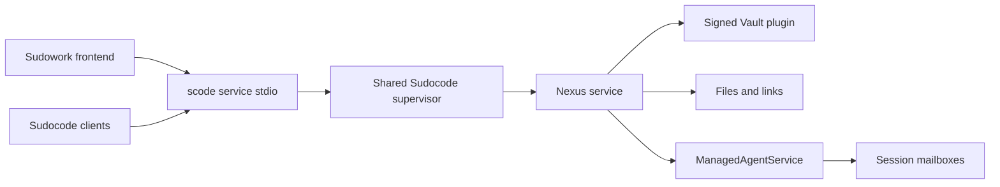

# Shared local services

Sudocode owns the local Nexus service used by its frontends. Each OS user has one
supervisor in a service root. The default root is `~/.nexus-vfs`;
`SCODE_SERVICE_ROOT` selects an absolute root for a container or an isolated test.



## Ownership and data

The supervisor retains `run/service.lock` for its lifetime. Clients discover it
through `run/service.json` and authenticate its loopback broker using the
connection token. Closing a frontend closes its process channel; the shared
service continues serving its other clients. An explicit shutdown drains requests
and releases the Nexus child. Managed runtimes keep the service in use.

Startup observes the same lifetime lock while a previous owner drains. A daemon
that loses the lock race exits rather than queueing to become an unexpected
future service. Its frontend reaps it and keeps observing ownership within the
original startup deadline; a vacant lock permits another launch. Authenticated
discovery, not a process exit or lock acquisition alone, establishes readiness.

`data/` holds durable Nexus and Vault content. `identity/` holds the service's
transport peer and zone membership identity, scoped to the same managed root.
`run/` holds discovery, locks and
diagnostics. Verified runtime assemblies live in `runtimes/`. Installation repair
and removal operate on assemblies and preserve `data/` and `identity/`.

The Nexus release comes from the workspace dependency in
[rust/Cargo.toml](../rust/Cargo.toml). Plugin releases and archive hashes come from
[runtime-artifacts.json](../rust/crates/service-host/runtime-artifacts.json).
Installation verifies archive hashes and stages a complete assembly before
publishing it atomically. Nexus verifies each plugin's detached signature when
loading it. Optional filesystem drivers follow their host prerequisites.

## Frontend channel

`scode service stdio` accepts one JSON request per line:

```json
{"id":1,"method":"vault.list","params":{"namespace":"service:mail"}}
```

Each response has the matching `id` and either `result` or `error`. A `null`
result is a valid result. Concurrent requests can complete in a different order;
the channel bounds the number of pending requests. Stream waits share the
connection with writes and other capability calls. Callers submit each write
once and treat a timeout as an unknown delivery outcome.

| Capability | Owner of its semantics |
| --- | --- |
| `service.*` | Sudocode installation, discovery and lifecycle |
| `vault.*` | Nexus GenericSecretsService |
| `files.*` | Nexus typed filesystem operations |
| `sessions.*` | ManagedAgentService and the published session mailbox protocol |
| `mounts.*` | Nexus filesystem driver services |

Frontends consume capabilities through the process channel. Sudocode holds the
kernel connection. Vault list responses contain metadata; values are read through
the value operation. Session addresses and message formats come from the control
plane and the published Nexus codec.

## Acceptance

[Shared services E2E](../.github/workflows/shared-services.yml) builds the actual
CLI on Linux, Windows and both macOS architectures. Its
[process harness](../e2e/shared-services/run.py) verifies signed runtime loading,
concurrent discovery, broker authentication, Vault versions, typed links, session
waits, runtime ownership and durable recovery after restart and installation
repair. A controlled real OS-lock handoff also checks that concurrent frontend
start requests recover after a retiring owner releases its lifetime lock.

On failure, the harness copies `run/runtime*.log` into the optional `--artifacts`
directory before removing its temporary root. CI retains the per-platform
`shared-services-<runner>` artifacts for seven days. To retain local evidence,
add `--artifacts ./shared-services-evidence` to the command below.

```sh
cargo build --manifest-path rust/Cargo.toml -p rusty-sudocode-cli
python e2e/shared-services/run.py --scode rust/target/debug/scode
```

Use `scode.exe` on Windows. Frontend acceptance lives with each frontend, including
Sudowork's desktop adapter and browser workflows.
